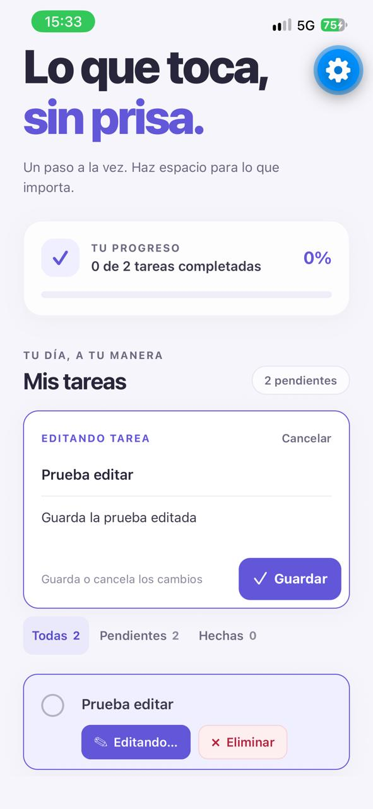
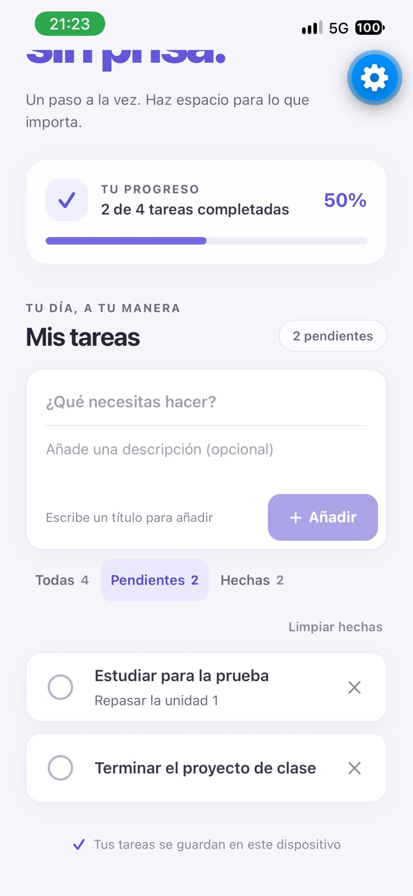
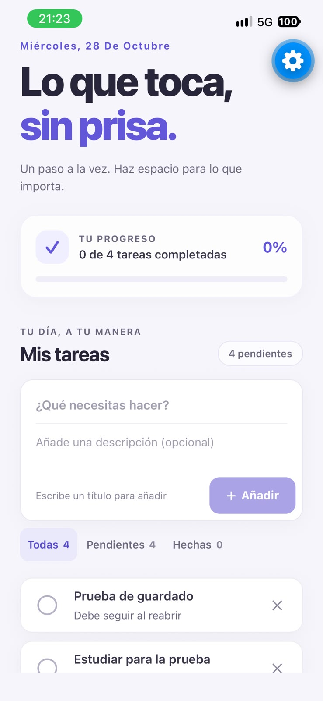
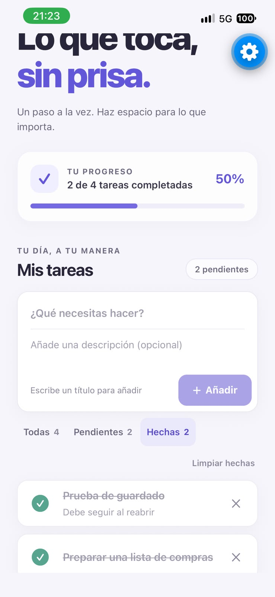
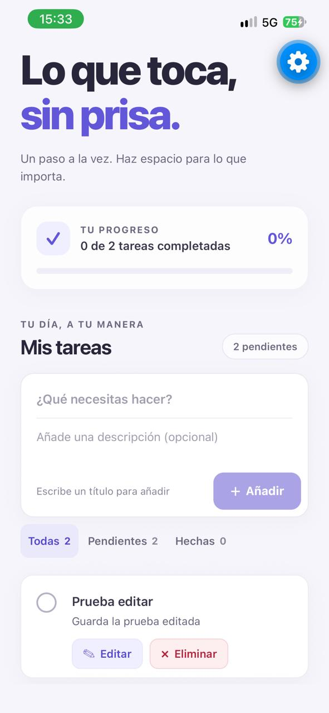

# Paso a paso — Lista de tareas en React Native

**Evaluación Unidad 1 · Desarrollo de Aplicaciones Móviles · Instituto Profesional San Sebastián**

| Dato | Detalle |
|---|---|
| **Institución** | Instituto Profesional San Sebastián |
| **Asignatura** | Desarrollo de Aplicaciones Móviles |
| **Docente** | Boris Belmar |
| **Integrantes** | Enderson Torres ([@3nd3rs0n](https://github.com/3nd3rs0n)) · Ezequiel Tobar ([@ezequieltobar](https://github.com/ezequieltobar)) · Diego Rivera ([@D3R5](https://github.com/D3R5)) |
| **Tecnología** | React Native 0.88 · Expo SDK 58 · TypeScript |
| **Repositorio** | https://github.com/3nd3rs0n/proyecto-mobile- |

Aplicación móvil para registrar y visualizar una lista de tareas pendientes. Cada tarea tiene **título y descripción**, y se puede **agregar, editar, completar y eliminar**. Además permite filtrar las tareas, ver el progreso y guarda la lista en el dispositivo.

<p align="center">
  
  &nbsp;
  
  &nbsp;
  
</p>

---

## Índice

1. [Por qué React Native](#1-por-qué-react-native)
2. [Cómo ejecutar la app](#2-cómo-ejecutar-la-app)
3. [Requisitos del enunciado](#3-requisitos-del-enunciado)
4. [Arquitectura y estructura del proyecto](#4-arquitectura-y-estructura-del-proyecto)
5. [Conceptos fundamentales de React Native](#5-conceptos-fundamentales-de-react-native)
6. [Patrones de diseño aplicados](#6-patrones-de-diseño-aplicados)
7. [Componentes de interfaz](#7-componentes-de-interfaz)
8. [Diseño de la interfaz y usabilidad](#8-diseño-de-la-interfaz-y-usabilidad)
9. [Pruebas](#9-pruebas)
10. [Capturas de pantalla](#10-capturas-de-pantalla)
11. [Trabajo en equipo](#11-trabajo-en-equipo)
12. [Uso de agentes de IA](#12-uso-de-agentes-de-ia)
13. [Próximos pasos](#13-próximos-pasos)

---

## 1. Por qué React Native

El enunciado propone Ionic, pero el docente autorizó cualquier framework, siempre que se justifique la elección. Elegimos **React Native con Expo y TypeScript**.

**React Native**
- **Demanda laboral.** Es uno de los frameworks móviles multiplataforma más usados en la industria y tiene más ofertas de trabajo que Ionic. Por esa misma razón el docente lo está usando en clases.
- **Componentes nativos reales.** Ionic dibuja la interfaz con HTML dentro de un *WebView*. React Native, en cambio, convierte `View`, `Text` o `TextInput` en vistas nativas de Android e iOS, así que la app se ve y se comporta como una app nativa.
- **Un solo código** para Android, iOS y web.

**Expo**
- No hace falta configurar código nativo ni Gradle para empezar.
- Con **Expo Go** se prueba la app al instante en un teléfono físico, escaneando un código QR. Así la probamos en un iPhone.
- Es la forma de crear proyectos que recomienda la documentación oficial de React Native.

**TypeScript**
- Detecta errores antes de ejecutar la app. El tipo `Task` funciona como contrato entre la interfaz, la lógica y el almacenamiento: si alguien escribe `titulo` en vez de `title`, el editor lo marca de inmediato.

> **Sobre `localhost:8100`:** ese puerto es el que usa el servidor de desarrollo de Ionic. Expo trabaja distinto: la app se abre en el teléfono escaneando el código QR, o en el emulador de Android Studio. Por eso ese punto del enunciado no aplica a nuestra tecnología.

---

## 2. Cómo ejecutar la app

**Requisitos:** Node.js 20 o superior, npm, y Expo Go en el teléfono (o un emulador de Android Studio).

```bash
npm install
npm start
```

- **Teléfono físico:** escanear el código QR con Expo Go. El teléfono y el computador deben estar en la misma red Wi-Fi.
- **Emulador Android:** con el emulador de Android Studio abierto, ejecutar `npm run android`.
- **Proyecto nativo:** se genera con `npx expo prebuild --platform android`.

**Revisar tipos y ejecutar las pruebas:**

```bash
npm run typecheck
npm test
```

---

## 3. Requisitos del enunciado

| Requisito | Estado | Dónde está |
|---|---|---|
| Cada tarea tiene título y descripción | ✅ | `src/types/task.ts` |
| Página principal con la lista de tareas | ✅ | `App.tsx`, `TaskList`, `TaskItem` |
| Formulario para ingresar tareas | ✅ | `TaskForm` |
| Agregar una tarea | ✅ | `createTask()` en `src/domain/task-operations.ts` |
| Limpiar los campos después de agregar | ✅ | `TaskForm` |
| **Editar** una tarea | ✅ | `updateTask()` + modo edición de `TaskForm` |
| Botón eliminar junto a cada tarea | ✅ | `TaskItem` |
| Eliminar una tarea específica | ✅ | `deleteTask()` filtra por `id` |
| **Extra:** marcar como completada, filtros y progreso | ✅ | `toggleTask()`, `task-selectors.ts` |
| **Extra:** guardar en el dispositivo | ✅ | `src/repositories/` (AsyncStorage) |

El enunciado deja el almacenamiento local para las próximas unidades; ya está implementado.

---

## 4. Arquitectura y estructura del proyecto

```
App.tsx                               Pantalla principal: une la lógica con la interfaz
src/
├── components/                       INTERFAZ (solo dibujan y avisan eventos)
│   ├── app-header.tsx                Marca, fecha y mensaje principal
│   ├── progress-card.tsx             Progreso de tareas completadas
│   ├── task-form.tsx                 Formulario para añadir y editar
│   ├── filter-bar.tsx                Filtros Todas / Pendientes / Hechas
│   ├── task-list.tsx                 Lista y mensaje cuando está vacía
│   └── task-item.tsx                 Una tarea con completar, editar y eliminar
├── hooks/use-tasks.ts                ESTADO: conecta React con el dominio y el repositorio
├── domain/                           REGLAS (funciones puras, sin React ni AsyncStorage)
│   ├── task-operations.ts            Crear, editar, completar, eliminar, limpiar
│   └── task-selectors.ts             Filtros y resumen de progreso
├── repositories/                     ALMACENAMIENTO
│   ├── task-repository.ts            Contrato: load() y save()
│   └── storage-task-repository.ts    Implementación con almacenamiento clave-valor
├── composition/task-dependencies.ts  Configura AsyncStorage y la generación de ids
├── constants/                        Tema visual y tareas de ejemplo
└── types/task.ts                     Modelo de datos
tests/                                Pruebas automáticas del dominio y del repositorio
docs/capturas/                        Capturas usadas en este informe
```

### Capas y flujo de datos

```
        ┌───────────────────────── App.tsx ─────────────────────────┐
        │  AppHeader · ProgressCard · TaskForm · FilterBar · TaskList │  ← components (UI)
        └───────────────▲──────────────────────────────┬────────────┘
                 datos  │ (props)            eventos   │ (onSubmit, onEdit, onDelete…)
                        │                              ▼
                 ┌──────┴──────────── useTasks() ────────────────┐                ← hook (estado)
                 └──────┬──────────────────────────────┬─────────┘
                        ▼                              ▼
              domain/ (funciones puras)      TaskRepository (load / save)      ← reglas | almacenamiento
                                                       ▼
                                                  AsyncStorage
```

- **Los datos bajan** como props: las tareas, el progreso y la tarea en edición.
- **Los eventos suben** como funciones: `onSubmit`, `onEdit`, `onToggle` y `onDelete`.
- **Las reglas no dependen de React ni de AsyncStorage**, así que se pueden probar solas.

---

## 5. Conceptos fundamentales de React Native

| Concepto | Qué es | Ejemplo en el proyecto |
|---|---|---|
| **Componente** | Función que recibe datos y devuelve interfaz. | `TaskItem` dibuja una tarea. |
| **JSX** | Sintaxis parecida a HTML para describir la interfaz. | `<Text style={styles.title}>{task.title}</Text>` |
| **Props** | Datos que un componente padre entrega a un hijo; son de solo lectura. | `TaskItem` recibe `task`, `onEdit` y `onDelete`. |
| **Estado (`useState`)** | Datos que cambian; al cambiar, React vuelve a dibujar. | Lista de tareas en `useTasks`, texto del formulario en `TaskForm`. |
| **Efecto (`useEffect`)** | Código que se ejecuta cuando cambia un valor. | Cargar y guardar en AsyncStorage; llenar el formulario al editar. |
| **Hook personalizado** | Función que agrupa estado y lógica reutilizable. | `useTasks()` |
| **`ref` (`useRef`)** | Acceso directo a un elemento nativo. | Mover el cursor al título, hacer scroll hasta el formulario. |
| **Componentes nativos** | `View`, `Text`, `TextInput` y `Pressable` se convierten en vistas nativas. | Todos los componentes usan solo primitivas de React Native. |
| **StyleSheet y Flexbox** | Estilos en objetos de JavaScript; el diseño usa Flexbox. | `StyleSheet.create({...})` al final de cada componente. |
| **Inmutabilidad** | El estado no se modifica: se crea una copia nueva. | `map` para editar y completar, `filter` para eliminar. |
| **Keys en listas** | Identificador único para que React sepa qué elemento cambió. | `key={task.id}` en `TaskList`. |

**Arquitectura del framework.** El código TypeScript/JSX lo empaqueta **Metro** y lo ejecuta el motor de JavaScript del teléfono. React calcula qué cambió en la interfaz y React Native actualiza solo esas vistas nativas. Con **Fast Refresh**, cada cambio se ve en el teléfono al guardar el archivo.

---

## 6. Patrones de diseño aplicados

### 6.1 Arquitectura por capas
Cada carpeta tiene una responsabilidad: `components` dibuja, `hooks` maneja el estado, `domain` define las reglas y `repositories` guarda los datos. Para cambiar cómo se ve una tarea se toca un solo componente; para cambiar dónde se guarda, solo el repositorio.

### 6.2 Repositorio (*Repository*)
La app no usa AsyncStorage directamente: depende de un **contrato**.

```ts
export interface TaskRepository {
  load(): Promise<Task[] | null>;
  save(tasks: readonly Task[]): Promise<void>;
}
```

Si en la Unidad 3 las tareas pasan a una API, se crea otro repositorio que cumpla este contrato y el resto de la app no cambia.

### 6.3 Inyección de dependencias y raíz de composición
`useTasks` **recibe** el repositorio y el generador de ids en vez de crearlos. Se configuran en un solo lugar, `src/composition/task-dependencies.ts`:

```ts
useTasks(taskRepository, createTaskId);
```

Gracias a esto, las pruebas pueden usar un almacenamiento falso en memoria.

### 6.4 Funciones puras e inmutables
Las reglas en `src/domain` reciben una lista y devuelven una **nueva**, sin modificar la original:

```ts
export function updateTask(tasks: readonly Task[], id: string, { title, description }: TaskInput): Task[] {
  const cleanTitle = title.trim();
  if (!cleanTitle) return [...tasks];
  return tasks.map((task) =>
    task.id === id ? { ...task, title: cleanTitle, description: description.trim() } : task,
  );
}
```

### 6.5 Hook personalizado
`useTasks()` reúne el estado, la carga y el guardado, y entrega al componente solo lo que necesita: `tasks`, `addTask`, `updateTask`, `deleteTask`, etc.

### 6.6 Componentes presentacionales y contenedor
Los componentes de `src/components` **no saben cómo se guardan las tareas**: reciben datos y avisan eventos. `App.tsx` es el **contenedor** que los conecta con el hook.

### 6.7 Componentes controlados
El valor de cada campo sale del estado. Por eso **limpiar el formulario** o **llenarlo al editar** es solo cambiar ese estado:

```tsx
<TextInput value={title} onChangeText={setTitle} />
```

### 6.8 Constantes de diseño (*design tokens*)
Colores, tamaños de letra, radios y sombras están en `src/constants/theme.ts`. Ningún componente escribe un color "a mano".

---

## 7. Componentes de interfaz

### Equivalencia con los componentes de Ionic del enunciado

| Ionic (enunciado) | React Native (este proyecto) | Componente |
|---|---|---|
| `ion-header` | `View` + `Text` con `accessibilityRole="header"` | `AppHeader` |
| `ion-content` | `SafeAreaView` + `ScrollView` + `KeyboardAvoidingView` | `App.tsx` |
| `ion-list` | `View` que recorre las tareas con `map` | `TaskList` |
| `ion-item` | `View` con casilla, título, descripción y botones | `TaskItem` |
| `ion-input` | `TextInput` | `TaskForm` |
| `ion-button` | `Pressable` | `TaskForm`, `TaskItem`, `FilterBar` |

### Cómo funciona editar
1. Se toca el botón **✎ Editar** de una tarea.
2. La pantalla sube hasta el formulario, que se llena con el título y la descripción, muestra **"EDITANDO TAREA"** y deja el cursor en el título. La tarjeta que se edita queda resaltada y su botón cambia a **"Editando…"**.
3. **Guardar** aplica los cambios y conserva el estado (completada o no) y la posición de la tarea. **Cancelar** descarta los cambios.
4. En ambos casos el formulario vuelve a **"Añadir"** y queda vacío.

---

## 8. Diseño de la interfaz y usabilidad

| Principio | Cómo se aplicó |
|---|---|
| **Jerarquía visual** | El título principal mide 49 px, los títulos de sección 24 px, los títulos de tarea 15 px y las descripciones 13–14 px en gris. Lo más importante se ve primero. |
| **Contraste** | Texto oscuro (`#28263A`) sobre fondo claro; el morado se reserva para acciones y estados activos. |
| **Balance** | Encabezado, progreso, formulario y lista comparten el mismo ancho y márgenes. En pantallas anchas el contenido se centra con un máximo de 760 px. |
| **Ritmo** | Tarjetas con el mismo radio, borde y sombra, y separaciones constantes entre ellas. |
| **Proporción** | Ningún texto mide menos de 11 px y todas las zonas táctiles miden al menos 44 px. |

**Usabilidad**
- Los botones de cada tarea tienen **ícono y texto** (**✎ Editar** y **× Eliminar**), así un usuario nuevo sabe qué hace cada uno sin adivinar. El de eliminar va en rojo para distinguirlo.
- Los botones **Añadir** y **Guardar** se deshabilitan si no hay título, con un mensaje que explica por qué.
- Los campos **se limpian** al guardar y, al presionar "siguiente" en el título, el cursor pasa a la descripción.
- El **modo edición** se distingue claramente: tiene su propia etiqueta, la tarjeta queda resaltada y aparece un botón Cancelar.
- Las tareas completadas quedan **tachadas** y la barra de progreso muestra el avance.
- Cuando no hay tareas, aparece un **mensaje** que explica qué hacer.
- **Accesibilidad:** cada botón tiene una etiqueta para lectores de pantalla, por ejemplo "Editar Estudiar para la prueba".

---

## 9. Pruebas

### Pruebas automáticas (`npm test`): 18 pruebas

| Archivo | Qué prueba |
|---|---|
| `tests/task-domain.test.ts` | Crear (con y sin descripción, título vacío), **editar** (cambia título y descripción, conserva id, estado y posición, título vacío e id inexistente), completar, eliminar, limpiar hechas, filtros y progreso. |
| `tests/task-repository.test.ts` | Distingue "sin datos" de una lista vacía, guarda y recarga sin compartir estado, mantiene la clave y el formato JSON, acepta tareas antiguas sin descripción y descarta registros inválidos, rechaza JSON corrupto, propaga errores de lectura y escritura, y prueba un flujo completo (añadir, completar, filtrar, limpiar, eliminar y recargar). |

### Pruebas manuales en teléfono (iPhone, Expo Go)

| # | Prueba | Resultado |
|---|---|---|
| 1 | Agregar una tarea con título y descripción; los campos quedan vacíos | ✅ |
| 2 | Sin título, el botón Añadir está deshabilitado | ✅ |
| 3 | Completar una tarea actualiza el progreso | ✅ |
| 4 | Eliminar solo la tarea elegida | ✅ |
| 5 | Filtros Todas / Pendientes / Hechas y Limpiar hechas | ✅ |
| 6 | Cerrar y volver a abrir la app conserva las tareas | ✅ |
| 7 | Editar: el formulario se llena, Guardar aplica los cambios, Cancelar los descarta | ✅ |

---

## 10. Capturas de pantalla

**En iPhone (Expo Go)**

| Tarea con descripción | Se mantiene al reabrir | Completar tarea |
|:---:|:---:|:---:|
|  |  |  |

| Filtro Pendientes | Filtro Hechas |
|:---:|:---:|
|  |  |

**Editar una tarea**

| Editando (formulario y tarjeta resaltada) | Después de guardar |
|:---:|:---:|
|  |  |

---

## 11. Trabajo en equipo

Cada integrante trabajó en su propia rama y la integró a `main`.

| Integrante | Aporte | Commits / PR |
|---|---|---|
| **Enderson Torres** ([@3nd3rs0n](https://github.com/3nd3rs0n)) | Creación del proyecto con Expo y React Native, primera versión de la app (completar, filtros, progreso y guardado en el dispositivo). | Commit inicial |
| **Ezequiel Tobar** ([@ezequieltobar](https://github.com/ezequieltobar)) | Interfaz: separó la app en componentes, agregó la **descripción** de las tareas, el tema visual, y mejoró la legibilidad y los tamaños táctiles. Luego agregó **editar tareas** y este informe. | PR #1 · rama `editar-tareas` |
| **Diego Rivera** ([@D3R5](https://github.com/D3R5)) | Lógica y pruebas: capa de **dominio**, patrón **repositorio**, inyección de dependencias y **15 pruebas automáticas**. | Commit en `main` |

---

## 12. Uso de agentes de IA

El docente permite el desarrollo potenciado por agentes. Como equipo, usamos asistentes de IA como apoyo durante el desarrollo: para analizar el enunciado y la rúbrica, proponer y revisar código, y redactar la documentación.

Las decisiones técnicas, la revisión del código y las pruebas fueron nuestras: cada integrante subió su parte en su propia rama y la app se probó en un teléfono físico.

**Lo que aprendimos:** la IA acelera el trabajo, pero hay que verificar lo que produce. Por eso revisamos el código con TypeScript (`npm run typecheck`) y con las pruebas automáticas (`npm test`), y probamos la app en el teléfono.

---

## 13. Próximos pasos

La arquitectura ya está preparada para lo que pide el enunciado en las próximas unidades:

- **Autenticación de usuarios:** agregar una pantalla de inicio de sesión y navegación entre pantallas.
- **Comunicación con APIs externas:** crear un `ApiTaskRepository` que cumpla el contrato `TaskRepository`. El hook, el dominio y la interfaz no cambian.
