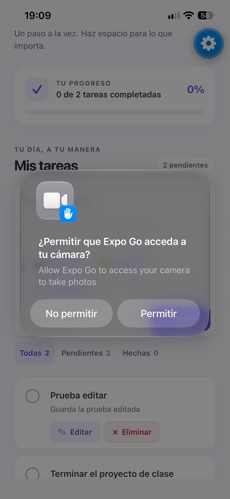
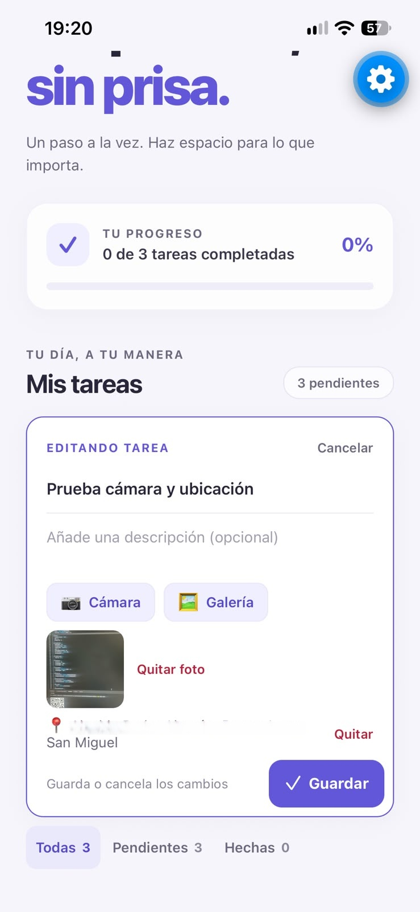
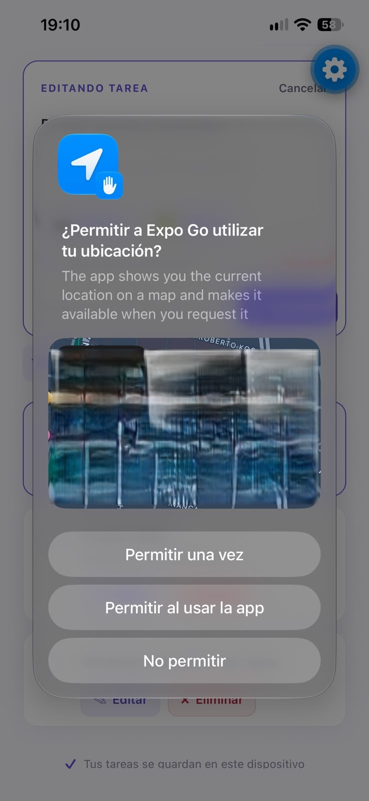
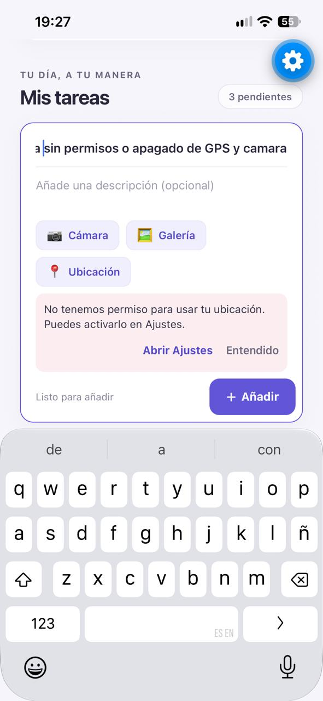

## Periféricos: cámara, GPS y permisos

**Responsable:** Ezequiel Tobar ([@ezequieltobar](https://github.com/ezequieltobar)) · rama `perifericos`

Cada tarea puede llevar una **foto** (tomada con la cámara o elegida de la galería) y la **ubicación** donde se creó. La foto y la ubicación se agregan desde el formulario; la tarjeta de la tarea muestra la foto y un enlace para ver el lugar en el mapa.

### Equivalencia con los plugins de Capacitor del enunciado

El enunciado pide plugins de Capacitor, que se usan con Ionic. En React Native con Expo, el equivalente son las librerías del SDK de Expo: igual que Capacitor, son un puente entre TypeScript y el código nativo de iOS y Android.

| Para qué | Capacitor (enunciado) | Expo (este proyecto) |
|---|---|---|
| Cámara y galería | `@capacitor/camera` | `expo-image-picker` |
| GPS | `@capacitor/geolocation` | `expo-location` |
| Textos de permisos | Editar `Info.plist` y `AndroidManifest.xml` a mano | `plugins` en `app.json` (Expo genera los archivos nativos) |

### Arquitectura

Cada periférico se separa en dos piezas:

```
Pantalla ──► Servicio (decisiones)          ──► Adaptador (traducción) ──► Librería de Expo
             · pide el permiso                  · sin decisiones propias
             · distingue cancelar de error
             · nunca lanza errores a la pantalla
```

| Archivo | Qué hace |
|---|---|
| `src/types/device.ts` | `DeviceResult`: el resultado común de todos los periféricos (`ok`, `cancelled`, `permission-denied`, `unavailable`, `error`). |
| `src/services/permission-service.ts` | Revisa y pide permisos; distingue `denied` (se puede volver a preguntar) de `blocked` (solo desde Ajustes). |
| `src/services/camera-service.ts` | Tomar una foto o elegirla de la galería. |
| `src/services/location-service.ts` | Ubicación con tiempo límite, última ubicación conocida y dirección. |
| `src/composition/device-dependencies.ts` | Adaptadores sobre `expo-image-picker` y `expo-location` (raíz de composición). |
| `src/domain/device-notice.ts` · `src/domain/task-location.ts` | Funciones puras: mensajes para el usuario, validación de coordenadas, dirección y enlace al mapa. |
| `src/hooks/use-task-attachments.ts` · `src/components/task-attachments.tsx` | Estado y vista de la foto, la ubicación y los avisos en el formulario. |

**Patrones aplicados**

- **Adaptador (*Adapter*):** la app nunca llama a Expo directamente; si cambia la librería, solo cambia `device-dependencies.ts`.
- **Inyección de dependencias:** cada servicio recibe sus adaptadores, la hora (`now`) y el tiempo límite como parámetros. En las pruebas se reemplazan por versiones falsas, sin teléfono.
- **Unión discriminada (`DeviceResult`):** TypeScript obliga a la pantalla a manejar cada caso (cancelado, sin permiso, no disponible, error) antes de usar la foto o la ubicación.
- **Contrato primero:** los contratos de los servicios se acordaron y se unieron a `main` (PR #3) antes de implementarlos, para que el equipo trabajara en paralelo.

### Permisos

| Decisión | Por qué |
|---|---|
| El permiso se pide **al tocar el botón**, no al abrir la app | El usuario entiende para qué se pide en ese momento. |
| Cada texto de `app.json` explica **para qué** se usa el permiso | "Usa la cámara para adjuntar una foto a tus tareas", no solo "usa la cámara". |
| **La galería no pide permiso** | Desde iOS 14 y Android 13, la galería es un selector del sistema que corre fuera de la app: el usuario ve todas sus fotos, pero la app solo recibe la que elige. |
| **Sin micrófono** (`microphonePermission: false`) | Solo se toman fotos; `expo-image-picker` lo pediría por defecto para grabar video. |
| **Ubicación solo mientras se usa la app** (`WhenInUse`) | Solo se necesita al crear la tarea; nunca se pide en segundo plano. |
| Permiso **bloqueado** → aviso con botón **"Abrir Ajustes"** | Si el usuario eligió "No permitir", el sistema ya no muestra el diálogo; la única forma de activarlo es desde Ajustes. |
| Ante un error de la librería, el permiso se informa como `denied` | Mostrar "actívalo en Ajustes" sería falso si el permiso no está bloqueado. |

> **Nota sobre Expo Go:** al probar en Expo Go, el diálogo muestra los textos de Expo Go (en inglés), no los de `app.json`. Nuestros textos se aplican al compilar la app propia (`npx expo prebuild` o una build).

### Cámara

- Foto comprimida al 70 % (`quality: 0.7`) para ocupar menos espacio en el teléfono, solo imágenes (sin video).
- Cerrar la cámara o la galería sin elegir es una **cancelación**, no un error: no se muestra ningún aviso.
- La foto que entrega la cámara es **temporal**; guardarla de forma permanente es parte del almacenamiento (ver sección de Enderson Torres).

### GPS

| Situación | Qué hace la app |
|---|---|
| Localización del teléfono apagada | Avisa "La ubicación del teléfono está desactivada." |
| El GPS no responde en **10 segundos** o falla | Usa la última ubicación conocida, solo si tiene **menos de 5 minutos** |
| Sin lectura actual ni reciente | Avisa que no se pudo obtener a tiempo |
| Coordenadas fuera de rango | Las rechaza |
| Ubicación aproximada (el usuario desactivó "Ubicación precisa") | La acepta y la muestra con "(aprox.)" |
| No se pudo obtener la dirección | Guarda la ubicación igual y muestra las coordenadas |

- **Precisión `Balanced`** (~100 m) en vez de la máxima: responde más rápido y gasta menos batería; para saber dónde se creó una tarea es suficiente.
- La dirección se obtiene con el geocodificador **del propio teléfono** (`reverseGeocodeAsync`), sin servicios externos.
- Al editar una tarea, su ubicación original se conserva: representa dónde se **creó**.

### Pruebas automáticas (`npm test`): 32 pruebas nuevas

| Archivo | Pruebas | Qué prueba |
|---|---|---|
| `tests/permission-service.test.ts` | 8 | No vuelve a preguntar si ya hay permiso; pregunta solo si se puede; **no pregunta si está bloqueado**; un error de la librería no llega a la pantalla; usa el permiso de cada tipo; abre Ajustes. |
| `tests/camera-service.test.ts` | 6 | Sin permiso **no abre la cámara**; cancelar no es un error; un error de la librería se devuelve como resultado; **la galería no pide permisos**. |
| `tests/location-service.test.ts` | 14 | Tiempo límite y última ubicación conocida; **descarta una ubicación de más de 5 minutos** (probado justo en el límite); GPS apagado; coordenadas fuera de rango; ubicación aproximada; la dirección falla sin perder la ubicación; enlace al mapa de cada plataforma. |
| `tests/device-notice.test.ts` | 4 | "Abrir Ajustes" solo con el permiso bloqueado; **nunca muestra el error técnico** al usuario. |

**Técnicas usadas**

- **Versiones falsas (*fakes*)** de la cámara, el GPS y los permisos, que además **cuentan las llamadas**: así se comprueba lo que el servicio *no* hace (por ejemplo, que con el permiso bloqueado `request()` nunca se llama).
- **Tiempo controlado:** la prueba fija la hora con `now: () => NOW` y simula un GPS que nunca responde, con un tiempo límite de 20 ms.
- **Probar la prueba:** se introdujeron errores a propósito en el código (no revisar el permiso, tratar la cancelación como error, aceptar ubicaciones antiguas, dejar que la dirección haga fallar todo) y se comprobó que alguna prueba fallara en cada caso.

Los adaptadores de `device-dependencies.ts` no tienen pruebas automáticas a propósito: solo traducen el formato de Expo, sin decisiones. Se verifican con las pruebas en el teléfono.

### Un error encontrado en el teléfono

Las pruebas automáticas pasaban, pero al apagar la Localización del iPhone la app decía "No tenemos permiso" en vez de "La ubicación está desactivada". La causa: **con la Localización apagada, iOS informa el permiso de todas las apps como denegado**, y el servicio revisaba el permiso antes que el GPS.

Se invirtió el orden (primero el GPS, luego el permiso) y se agregó una prueba que reproduce el comportamiento de iOS: GPS apagado *y* permiso bloqueado. Con el orden anterior, esa prueba falla.

### Pruebas manuales en teléfono (iPhone, Expo Go)

| # | Prueba | Resultado |
|---|---|---|
| 1 | Tocar Cámara por primera vez muestra el diálogo de permiso | ✅ |
| 2 | Tomar una foto muestra la miniatura con "Quitar foto" | ✅ |
| 3 | Cerrar la cámara sin tomar foto no muestra ningún aviso | ✅ |
| 4 | La galería se abre sin pedir permiso | ✅ |
| 5 | Tocar Ubicación muestra "Buscando…" y luego la dirección | ✅ |
| 6 | El diálogo de ubicación solo ofrece "una vez" o "al usar la app" | ✅ |
| 7 | Cámara bloqueada en Ajustes → aviso con "Abrir Ajustes" | ✅ |
| 8 | Ubicación bloqueada en Ajustes → aviso con "Abrir Ajustes" | ✅ |
| 9 | "Abrir Ajustes" abre los Ajustes de la app | ✅ |
| 10 | Localización del teléfono apagada → "La ubicación del teléfono está desactivada." | ✅ |
| 11 | Cerrar la app por completo y volver a abrirla conserva la foto de la tarea | ✅ |
| 12 | Editar una tarea con foto y tomar otra: la tarjeta muestra la nueva | ✅ |

Las pruebas 3 y 9 no tienen captura porque son transiciones (cerrar la cámara, abrir Ajustes): se verificaron en el teléfono, y su lógica está cubierta por las pruebas automáticas "cerrar la cámara sin tomar foto es una cancelación, no un error" y "openSettings abre los Ajustes".

### Capturas

| Permiso de cámara | Foto y ubicación en el formulario | Permiso de ubicación |
|:---:|:---:|:---:|
|  |  |  |

| Cámara bloqueada | Ubicación bloqueada |
|:---:|:---:|
|  |  |

> **Privacidad:** en las capturas se taparon el mapa y el nombre de la calle, porque el repositorio es público.

### Limitaciones conocidas

- En Expo Go los diálogos muestran los textos de Expo Go, no los de `app.json`.
- Si el teléfono no tiene cámara (por ejemplo, el simulador de iOS), se informa como error genérico: Expo no entrega una forma confiable de distinguir ese caso.
